<div align="center">

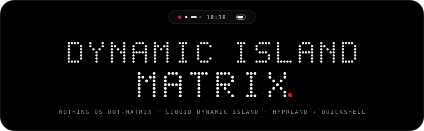

<br>

**Black `#000000` · White Dots `#F2F2F2` · One Nothing Red `#D71921`**  
A full-stack **Nothing OS Dot-Matrix & Liquid Dynamic Island** desktop environment for **Hyprland + Quickshell**, covering the entire lifecycle from **rEFInd → Plymouth → SDDM → Live Desktop → Ring-Unwind Shutdown**.

**纯黑底色 · 点阵字形 · 一抹 Nothing 红**  
基于 **Hyprland + Quickshell** 打造的全链路 **Nothing OS 点阵液态灵动岛桌面**，贯通 **rEFInd 引导 → Plymouth 内核动画 → SDDM 拨盘登录 → 液态灵动岛桌面 → 36 点退环关机**。

<br>

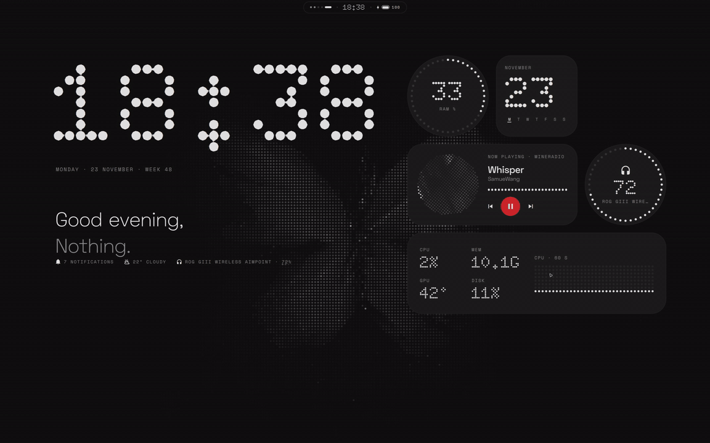

</div>

<div align="center"></div>

<h2 align="center">Motion Showcase · 动态实机演示</h2>

### 01 · Liquid Dynamic Island (`IslandChrome` + `CurveRenderer` @ 120Hz)

- **Resting Capsule（收起态纯黑胶囊）**：居中悬浮纯黑胶囊，滚轮或横滑在 **时间 + 电量** 与 **实时桌面歌词**（支持 `lyricsmpris` 与实时 JSON 歌词流）之间无缝切换；拖拽任意文件靠近胶囊自动张开文件暂存器。
- **Left-Click / `Super + A`（液态内凹耳控制中心）**：基于 `QtQuick.Shapes` (`CurveRenderer`) 单容器 GPU 矢量变形，零闪烁贴顶展开带 `22px` 液态内凹圆角的原生点阵控制中心（Wi-Fi、蓝牙、Nothing/CMF 耳机降噪、双语 Clash Verge VPN、性能档位、媒体与通知）。
- **Right-Click / `Super + R`（四合一矩阵中枢）**：同一灵动岛容器内无缝切换 **`CALENDAR` 日历 · `FOCUS` 番茄专注 · `NOTES` 置顶便签 · `SHELF` 双向 Wayland 拖拽文件暂存架**。

<div align="center">

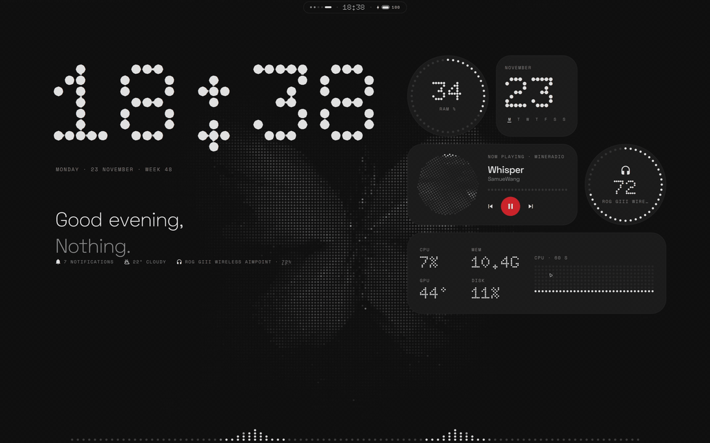

</div>

<br>

### 02 · 12-Slot Live Workspace & Scratchpad Overview (`ScreencopyView`)

- **10 + 2 全景槽位**：左侧 `2 × 5` 排布 `01–10` 普通工作区，右侧独立双暂存区列 **`SPECIAL`（上滑手势）** 与 **`MIN`（下滑手势）**。
- **60fps 零拷贝实时缩略图**：基于 Wayland `ScreencopyView` 实时渲染所有窗口动态画面；支持点击直达聚焦、中键关闭，以及在 **`01–10 ↔ SPECIAL ↔ MIN` 之间任意双向拖拽调度窗口**。

<div align="center">

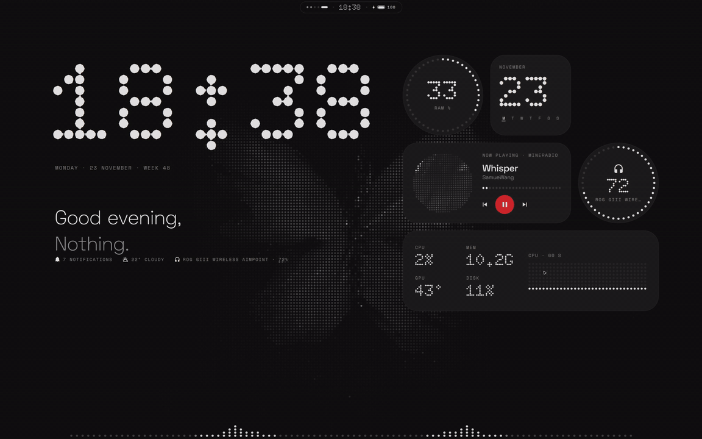

</div>

<br>

### 03 · Full Boot-to-Shutdown Nothing OS Continuity · 开机到关机全链路点阵动画

- **rEFInd UEFI Bootloader**：原生点阵横幅、红点选中环与全套单色点阵系统图标。
- **Plymouth Kernel Splash**：24 点 Nothing 矩阵圆环逐点点亮 + 中心红点脉冲 + 点阵字标。
- **SDDM Camera Dial Login**：相机拨盘会话切换 + 密码输入转速表点阵亮起。
- **36-Dot Ring Unwind Shutdown**：关机/重启触发 36 点圆环逆时针退环 → 水平白线坍缩 → 中心红点熄灭入纯黑。

<div align="center">

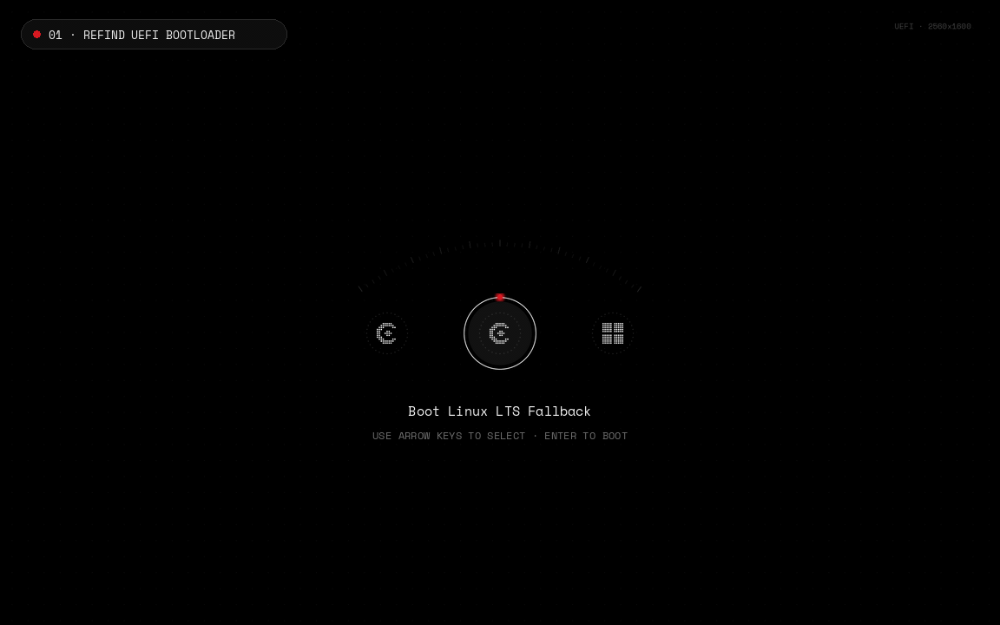

</div>

<div align="center"></div>

<h2 align="center">Detail Gallery · 界面细节一览</h2>

| | |
|:---:|:---:|
| 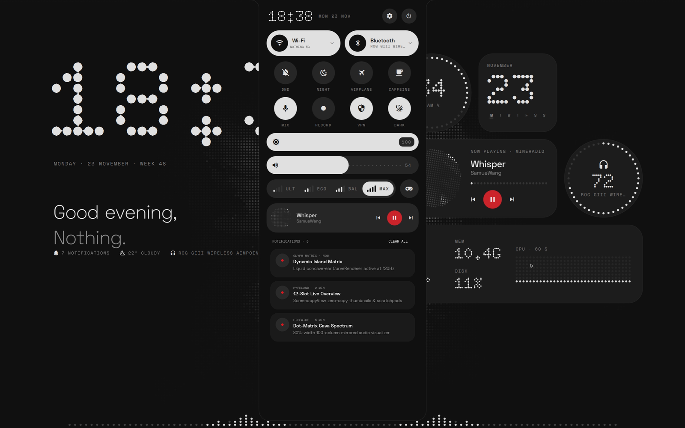 **Liquid Concave-Ear Control Center (`QuickPane`)** | 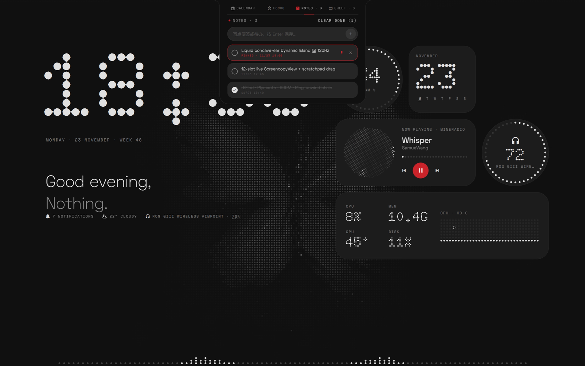 **Matrix Hub · Pinned Notes (`NOTES`)** |
| 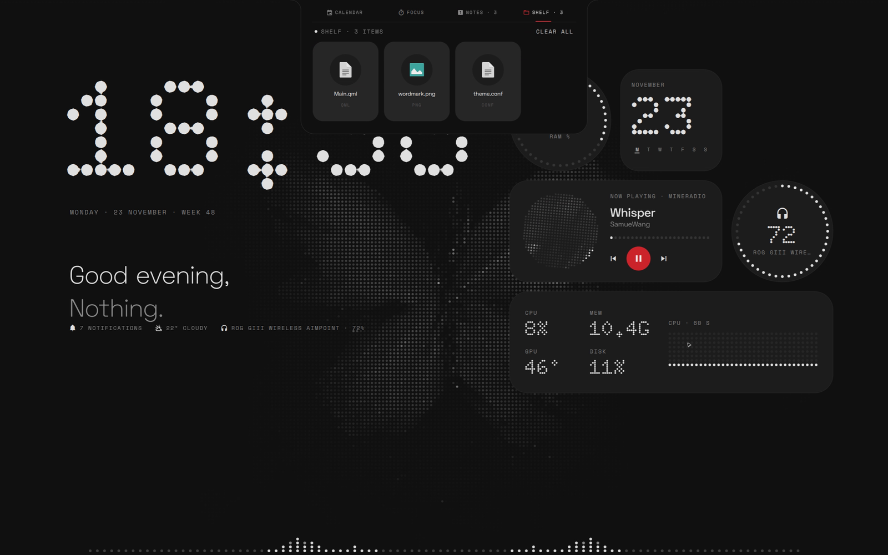 **Matrix Hub · Wayland File Drop Shelf (`SHELF`)** | 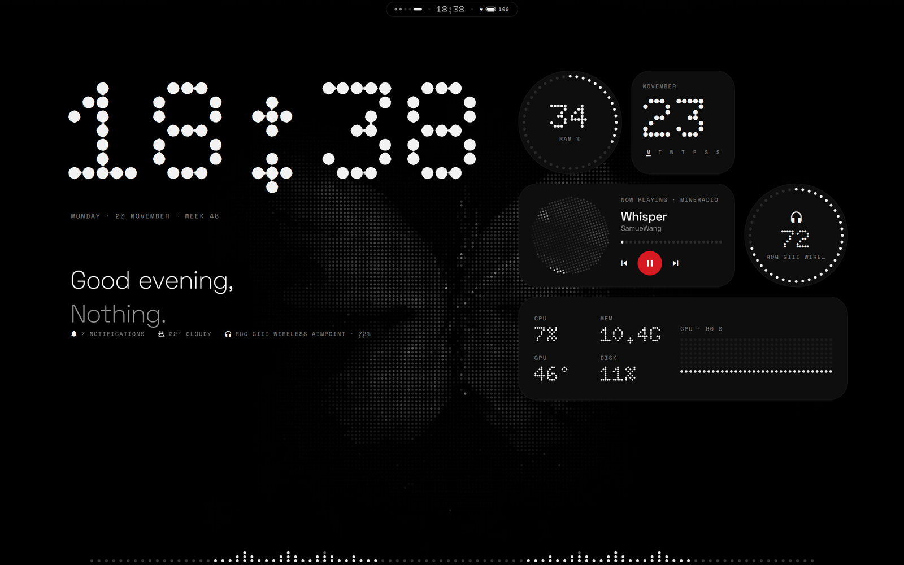 **Dot-Matrix App Launcher & Style Picker** |
| 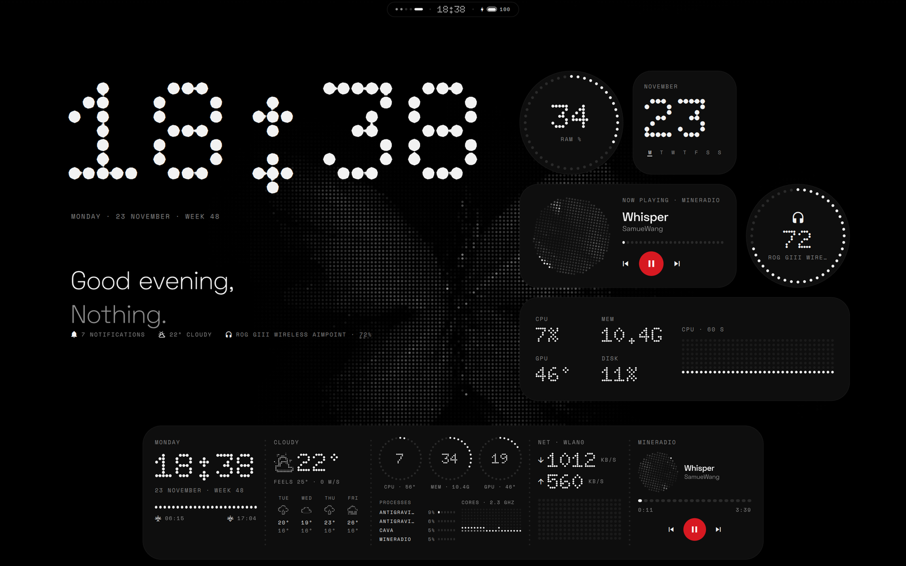 **Bottom Dashboard Deck (`Deck`)** | 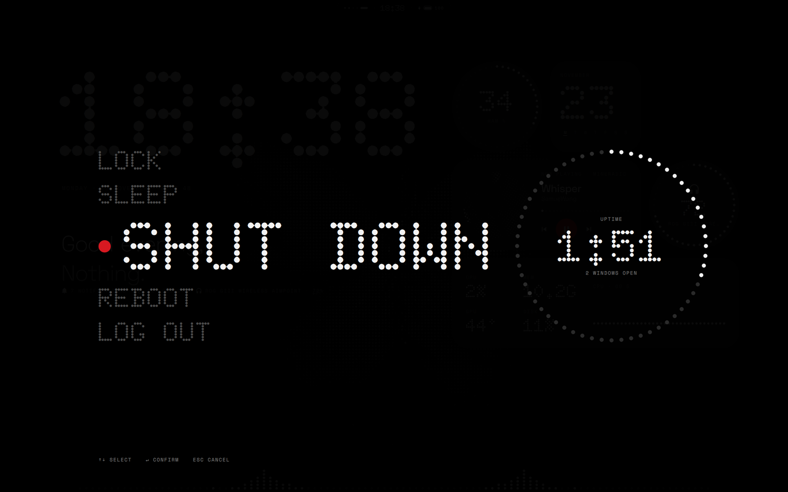 **Power Menu & Ring-Unwind Trigger** |

<div align="center"></div>

<h2 align="center">What's Inside · 核心模块</h2>

| Module | Description | Default Trigger |
|---|---|---|
| **Dynamic Island** | Floating capsule (`Time + Battery` ↔ `Live Lyrics`), morphs into top-docked concave-ear Control Center or 4-tab Matrix Hub | Left / Right Click · Scroll |
| **QuickPane** | Wi-Fi, Bluetooth, Nothing/CMF Buds ANC, DND, Night Light, Caffeine, Clash VPN, Brightness/Audio, Power Profiles, Media & Notifications | `Super + A` / Left-Click Island |
| **Matrix Hub** | `CALENDAR` · `FOCUS` timer · `NOTES` persistent todo/memo · `SHELF` bidirectional Wayland drag-and-drop file tray | `Super + R` / Right-Click Island |
| **Live Overview** | 12-slot (`01–10` + `SPECIAL` + `MIN`) live `ScreencopyView` workspace & scratchpad switcher with cross-slot drag-and-drop | `shell:overview` (`Alt + Tab` / `Super + Tab`) |
| **Empty-Desktop Cava** | Bottom `WlrLayer.Bottom` mirrored 100-column Nothing Dot-Matrix audio spectrum (`80%` screen width, Nothing Red peaks), auto-hides when windows open or audio stops | Automatic on empty workspace |
| **Home & Walls** | Giant `Doto` clock, greeting, Bento widgets (`CPU/MEM/GPU/DISK`, RAM dial, Calendar, Media vinyl, Buds), dot-matrix shader wallpapers | Empty workspace / `Super + Shift + W` |
| **Launcher / Deck** | Apps, calculator, live theme/palette previewer (`Nothing` / Wallpaper `Material You` / 8 classic palettes), bottom dashboard | `Super` / `Super + Space` |
| **Shot / Clip / VPN** | Region/screen capture + `gpu-screen-recorder`, `cliphist` manager, bilingual EN/ZH Clash Verge panel | `Print` · `Super + V` · `Super + P` |
| **Boot & Power Chain** | `extras/refind/glyph` · `extras/plymouth/glyph` · `config/sddm/glyph` · 36-dot unwind shutdown transition | `deploy.sh --boot` · `Super + Esc` |

<div align="center"></div>

<h2 align="center">Quick Install · 一键部署</h2>

```bash
git clone git@github.com:ezioeen1900/oupss.git ~/.local/share/glyph

# Desktop + packages + user services + symlinks (backs up existing configs to ~/.dots-backup-<date>/)
~/.local/share/glyph/deploy-ezioeen.sh

# Full stack including rEFInd, Plymouth (initramfs rebuild), and SDDM camera-dial login theme
~/.local/share/glyph/deploy-ezioeen.sh --boot

# Symlinks only (any Linux distro with Hyprland 0.56+ & Quickshell 0.3.1+)
~/.local/share/glyph/install.sh --links
```

### Personal Overrides (`config/hypr/user.lua`)
`config/hypr/user.lua` is gitignored so `git pull` never overwrites your monitor layout, input method, or personal keybinds:

```lua
-- ~/.config/hypr/user.lua
hl.config({
    monitor = { "eDP-1, 2560x1600@120, 0x0, 1.25" },
})

hl.bind("ALT + Tab", hl.dsp.global("shell:overview"))
hl.bind("SUPER + R", hl.dsp.global("shell:memo"))
```

### Touchpad Gestures (Built-in)
- **3-Finger Drag**: Move window smoothly
- **4-Finger Left / Right**: Switch workspaces horizontally (`slide`)
- **4-Finger Swipe Up / Down**: Open `special` / `min` scratchpad (or close any active scratchpad)
- **5-Finger Swipe Down**: Suspend (`systemctl suspend`)

<div align="center"></div>

<h2 align="center">Dependencies · 依赖环境</h2>

| Category | Packages |
|---|---|
| **Core Shell** | `quickshell` (0.3.1+, Qt 6.9+) · `hyprland` (0.56+ with Lua config) · `hypridle` · `hyprsunset` · `xdg-desktop-portal-hyprland` · `jq` · `curl` · `python3` · `libqalculate` |
| **System & Audio** | `sddm` (0.21+) · `networkmanager` · `bluez` · `blueman` · `pipewire` · `wireplumber` · `upower` · `power-profiles-daemon` · `brightnessctl` · `playerctl` |
| **Capture & Clipboard** | `grim` · `slurp` · `imagemagick` · `libvips` · `gpu-screen-recorder` · `cliphist` · `wl-clipboard` · `swappy` |
| **Terminal & Visuals** | `kitty` · `fish` · `starship` · `fastfetch` · `btop` · `cava` · `eza` · `zoxide` · `direnv` · `papirus-icon-theme` · `adw-gtk-theme` |
| **Optional** | `clash-verge-rev` (bilingual EN/ZH VPN panel) · `lyricsmpris` (live capsule lyrics) · `plymouth` · `refind` |

<div align="center"></div>

<h2 align="center">Palette & Credits · 配色与致谢</h2>

<div align="center"></div>

<br>

- Built upon the foundation of [**Glyph Rice**](https://github.com/Nebelung-cloud/glyph-rice) by [@Nebelung-cloud](https://github.com/Nebelung-cloud) (GPL-3.0), extended with the **Liquid Concave-Ear Dynamic Island**, **4-Tab Matrix Hub (`CALENDAR · FOCUS · NOTES · SHELF`)**, **12-Slot Live `ScreencopyView` Workspace & Scratchpad Overview**, **Empty-Desktop 80% Dot-Matrix Cava Visualizer**, and the **rEFInd + Plymouth + Ring-Unwind Boot/Shutdown Chain**.
